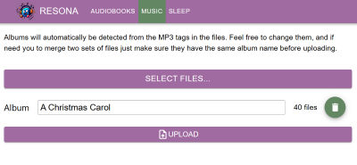

# Resona
An audiobook/music/sleep tunes audio player designed to run on a Raspberry Pi.


## Motivation

I wanted to have a single-use device for playing audio that my kids could safely use in their bedroom, without giving them a phone or tablet that also gave them other unhelpful distractions. 
Recent work has been on having a cheap second-hand Android device locked down in kiosk mode - that turns out to be
much cheaper and effective than buying a new Raspberry PI, screen, battery pack, etc.

# Features

## Three sections for audio content

* Audiobooks
* Music
* Sleep Tunes


Files are added to the database by scanning a folder on the local filesystem. This is currently the well known location, `home/pi/audiobooks`, `home/pi/music` and `home/pi/sleep`.

## Sleep timers

* Sleep timer to stop playback after a set time
* Auto-shutdown on lack of interactivity (2 hours by default)
* Screen dimming to prevent glare at night (30 seconds by default)


## Album art

Album art is loaded from (in order of preference):

* `image.jpg` or `image.png` in the album folder
* The first `mp3` file in the album folder that contains an embedded image


## Playback

* Resona keeps track of the last played position of albums and will be ready to continue playing from the last played track when it restarts
* Scrubbing supported
* Volume control through the player in case your display doesn't have volume controls


## Audio output selection

Select the audio output channel through the UI:


Scan for and pair bluetooth devices:


# Dev notes

## Raspberry Pi installation

1. Install Raspberry Pi OS Lite. The easiest way to do this is with the [Raspberry Pi Imager](https://www.raspberrypi.com/software/), making sure you apply these settings before installing:
  * Set the host name to something unique on your network, e.g. `dev`
  * Enable SSH
  * Configure the wireless LAN
1. Install any dependencies for the touchscreen display attached to your Pi. 
1. Use `raspi-config` and change `System options > Boot / Auto Login` to `Console Autologin`.
1. From your dev computer run `copy-pi-scripts.ps1 -Server <PiName>` which will copy Resona scripts to your Pi.
1. From your Pi (SSH or direct), run `./install-dependencies.sh` and use one of them to install the relevant dependencies
1. (Optional) From your Pi, run `./configure-auto-run.sh` to configure Resona to auto run whenever your Pi starts up. If you don't do this you'll have to manually start Resona each time from 
   either your dev computer using SSH or the Pi itself by running `~/bin/Resona --drm`. You can temporarily disable the service using `./disable-auto-run.sh` and re-enable with 
   `./reenable-auto-run.sh`.

## Build and deploy Resona to your Pi

Run `publish.ps1 -Server <PiName>` to build and deploy the project to your Pi.

`publish.ps1` options:

* `-Server` - The name of the Pi to deploy to
* `-DebugBuild` Builds in debug mode with no trimming
* `-NoClean` Only makes sense when used when publishing with -DebugBuild. Only copies changes to the Resona assemblies, keeping the existing .NET framework and other dependencies. Can be used for a faster dev inner loop when testing code on the Pi.
* `-NoBuild` Deploys without rebuilding the packaged artifacts

Publishing will:

* Rebuild the project
* Stop and disable the service on the Pi (which will kill the app if it's running via the service)
* Copy the updated artifacts
* Re-enable and start the service on the Pi (if installed) - the app will auto run ready for you to play with it.

## Experimental web host

Some work has been done to expose a React-based web interface from the Pi. It's turned off by default but can be enabled from the advanced settings page.

Once enabled, you can access the web interface from any device on the same network as the Pi by navigating to `http://<PiName>:8080`.

The web interface allows you to view what's currently in the library:


And also upload new content:



#### Web client development

The web host lives in `src/Resona.Web`. It is a small `System.Net.HttpListener` based server (so it also works on Android, where ASP.NET Core isn't available)
that serves the API under `/api` and the React/Vite client from `src/Resona.Web/ClientApp`, which is embedded in the assembly at build time.

* The client is built by an MSBuild target (`npm install` + `npm run build`). Release builds always rebuild it; Debug builds only build it if `ClientApp/dist` doesn't exist yet. Pass `-p:NoSpaBuild=true` to skip it entirely (the `publish.ps1 -NoSpaBuild` switch does this).
* For day-to-day client work, run the desktop app with the web client enabled (the API listens on `http://localhost:8080` when run on Windows, all interfaces elsewhere), then in `src/Resona.Web/ClientApp` run `npm run dev` and browse to `http://localhost:5002` - Vite hot reloads and proxies `/api` calls to port 8080.
* Tests for the web host are in `src/Resona.Web.Tests` (`dotnet test`) and don't need Node.

### Additional configuration

If you want to add a splash screen and get rid of all the scrolling boot up text the Pi shows, follow these steps:

1. Add the line `disable_splash=1` to `/boot/firmware/config.txt`.
1. Add `logo.nologo consoleblank=0 loglevel=1 quiet splash` to `/boot/firmware/cmdline.txt`.
1. Add a splashscreen
	1. Install `fbi` with `sudo apt install fbi`
	1. Create a splash screen image and save it as `/home/pi/splash.png`
	1. `sudo nano /etc/systemd/system/splashscreen.service` and enter
		```
		[Unit]
		Description=Splash screen
		After=local-fs.target

		[Service]
		ExecStart=/usr/bin/fbi -d /dev/fb0 --noverbose -a /home/pi/splash.png
		StandardInput=tty
		StandardOutput=tty

		[Install]
		WantedBy=sysinit.target
		```
	1. `sudo systemctl enable splashscreen.service`

### Touchscreen installation

This section contains notes about the various touchscreens used during development.

#### Wimaxit 7" Capacitive with sound

Add this to the end of /boot/firmware/config.txt:

```
hdmi_force_edid_audio=1
max_usb_current=1
hdmi_force_hotplug=1
config_hdmi_boost=7
hdmi_group=2
hdmi_mode=87
hdmi_drive=2
display_rotate=0
hdmi_cvt 1024 600 60 6 0 0 0
```

Enable fkms to fix audio issues:

```
sudo sed -i 's/dtoverlay=vc4-kms-v3d/dtoverlay=vc4-fkms-v3d/g' /boot/firmware/config.txt
```

#### 

## Database

Work on the core database structure is ongoing, so I'm just going to recreate the initial database structure every time I make a change using:

``` powershell
cd src\Resona.Persistence
rm -r Migrations
md Migrations
dotnet ef migrations add InitialCreate --startup-project ..\Resona.Desktop -o Migrations
```

## Android (experimental)

`src/Resona.Android` hosts the shared Resona UI on Android (landscape, single view). Audio playback uses the bundled native BASS
libraries (arm64-v8a and x86_64), and Bluetooth/battery/audio-output use the dev stubs.

Build and run on a connected device or emulator:

```
dotnet build src/Resona.Android -t:Run -f net11.0-android
```

The Android project is in `Resona.sln` but is deliberately excluded from the default solution build (so that
`dotnet build`/`dotnet test` on the solution don't need the Android workload or a device); build it explicitly as above.

Put your files in the app's external files folder, `/sdcard/Android/data/com.resona/files/{music,audiobooks,sleep}`
(created on first start), e.g. with `adb push`. The library is rescanned a few seconds after the app starts.

The web client is hosted by default on port 8080; the device addresses are written to logcat (tag `Resona`).
Open `http://<device-ip>:8080/` from another device, or use `adb forward tcp:8080 tcp:8080` and browse to
`http://localhost:8080/`. Files uploaded there land in the same folders.

### Android kiosk deployment

`scripts/android/Resona.Android.ps1` (PowerShell 7) builds, deploys and controls the app as a locked-down kiosk
(Device Owner + Lock Task: Resona is the only app, it is the HOME launcher, the status bar and keyguard are disabled).
Parent control is adb-only; there is no way out of the app on the device itself.

```
./scripts/android/Resona.Android.ps1 -Action Build
./scripts/android/Resona.Android.ps1 -Action Provision -Device <serial>   # first time
./scripts/android/Resona.Android.ps1 -Action Deploy                       # updates
./scripts/android/Resona.Android.ps1 -Action Status
./scripts/android/Resona.Android.ps1 -Action KioskOff   # temporarily back to a normal phone
./scripts/android/Resona.Android.ps1 -Action KioskOn
./scripts/android/Resona.Android.ps1 -Action Release    # removes device owner entirely (-Force skips the prompt)
./scripts/android/Resona.Android.ps1 -Action Logs
```

`-Device` is optional when exactly one device is attached; `ip:port` values trigger `adb connect` first.

**First-time provisioning** (device owner can only be set on a device with no accounts and a single user):

1. Remove every account: Settings -> Accounts (Google etc). On Xiaomi also sign out of / remove the Mi Account
   (and any "Second space"/work profile).
2. Enable Developer options (tap the build number 7 times), turn on USB debugging. On Xiaomi/MIUI/HyperOS also turn on
   "Install via USB" and "USB debugging (Security settings)" (needs a Mi account/SIM in some versions - sign in, enable them,
   then remove the Mi account again); otherwise installs fail with `INSTALL_FAILED_USER_RESTRICTED`.
3. Connect over USB and run `-Action Provision`. It checks the prerequisites, installs the signed APK, runs
   `dpm set-device-owner com.resona/com.resona.ResonaDeviceAdminReceiver`, launches the app and prints a PASS/WARN status.

**Updates**: `-Action Deploy` rebuilds, installs over the existing app (`adb install -r`) and relaunches.
On Xiaomi/MIUI the USB-install confirmation screen cannot appear while lock task is active (the install would be cancelled
with `INSTALL_FAILED_USER_RESTRICTED`), so when the app is the device owner and the kiosk is locked, `Deploy` (and `Provision`'s
install step) automatically runs `KioskOff`, installs, then `KioskOn` (always re-enabled, even if the install fails).
It also works over Wi-Fi with wireless debugging: `-Device IPADDRESS:37123`. Updates pulled from the NAS feed (below)
install silently inside the app, so they need no USB and no kiosk pause.

**LAN self-update** (no USB needed after the first install): the app can pull new builds from any plain web server on your LAN.

1. One time: install an update-capable build over USB with `-Action Deploy` (or `Provision`).
2. One time per device: `./scripts/android/Resona.Android.ps1 -Action SetUpdateSource -Url http://IPADDRESS:8000/`
   (`-Url ""` disables updates).
3. Routine release: `./scripts/android/Resona.Android.ps1 -Action Publish -PublishDir \\nas\web\resona`
   (or set `RESONA_PUBLISH_DIR` and omit the parameter; `-NoBuild` re-publishes the last build). This builds the signed APK,
   copies it as `resona-<versionCode>.apk`, atomically writes `resona-update.json` next to it
   (`{ "versionCode", "versionName", "apk", "sha256", "publishedUtc" }`) and deletes older APKs except the previous one.
4. `-Action CheckUpdate` triggers an immediate check; `-Action Status` shows the update source, last check time/result and
   the installed versionCode.

Serve the publish folder over HTTP (HTTP/1.1 is recommended), e.g. a NAS web share, IIS, or
`python -m http.server 8000 --protocol HTTP/1.1 --directory <dir>`. Cleartext HTTP is allowed by the app's network security
config because this is a LAN-only appliance.

The app checks about 30 seconds after start, then every 6 hours, and on `CheckUpdate`, but only while it is the device owner
and an update URL is set. If the manifest `versionCode` is higher than the installed one it downloads the APK to its cache,
verifies the SHA-256, then waits until nothing is playing (polling every minute) and installs silently with `PackageInstaller`
(no prompt, because it is device owner). The app is restarted by the system and the kiosk/lock task re-engages. Failures
(network, bad manifest, hash mismatch) are logged with tag `Resona`, recorded for `Status`, and retried next cycle.

Version rule: Android only installs an APK with a higher `versionCode`. The script sets `versionCode` to the number of minutes
since 2024-01-01 UTC on every `Build`/`Publish`/`Deploy`, so each build is newer than the last.

Security model: Android refuses to update an app with an APK signed by a different key, so only builds signed with your
`resona-release.keystore` can ever be installed, even if someone tampers with the web share; the SHA-256 in the manifest is
an additional integrity check, not the trust anchor. Keep the keystore safe.

**Parent control** (all via adb; the receiver is protected by the `DUMP` permission which only the adb shell holds):
`KioskOff` ends lock task and restores the normal launcher/status bar, `KioskOn` re-engages it, `Release` also removes the
device owner so the phone can be returned to normal use without a factory reset.

**Signing keystore**: release builds are signed with `~/.resona/resona-release.keystore` (password in
`~/.resona/resona-release.keystore.password`), created on the first `Build`. **Back both files up** - without the same key,
updates cannot be installed over the device-owner app and you would have to `Release`/reset the device. They live outside
the repository and must never be committed.
